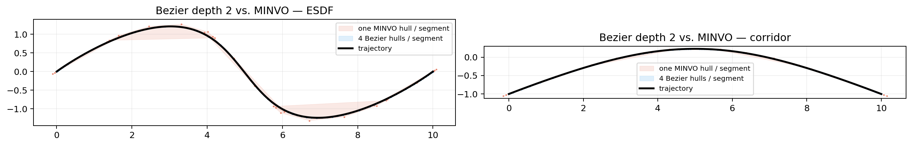
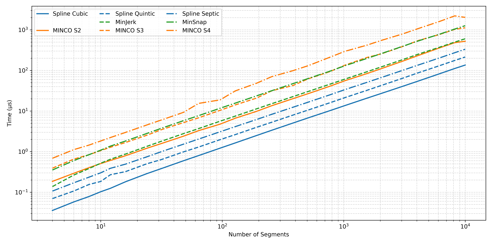
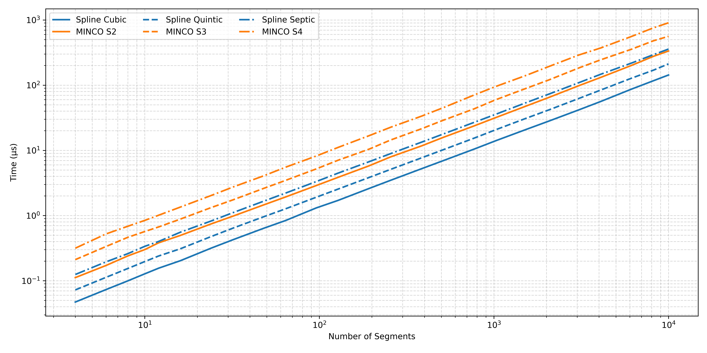
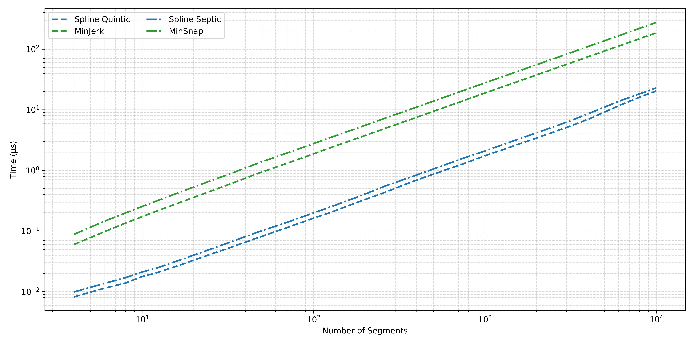

# SplineTrajectory

基于 C++17 / Eigen 的纯头文件 N 维最小控制量轨迹库。
与 [MINCO](https://github.com/ZJU-FAST-Lab/GCOPTER) 求解相同的夹持边界样条问题，
提供 O(N) 块三对角求解器、解析能量梯度、可组合的优化器接口，以及可微的凸包转换。

[English](README.md) | **中文**

[**HTML API 文档 · 中文 / English**](docs/api/index.html?lang=zh) — 本地打开即可查阅分类接口与维度表、双语搜索和交互曲线。

## ✨ 概览

- 任意维度的三次、五次和七次最小控制量样条。
- O(N) 构造与伴随反传，覆盖时长、插值点和边界状态。
- 基于 Hamiltonian 守恒与变分原理的解析能量梯度。
- 通用 `SplineOptimizer`，支持复用变量映射与目标组件。
- 顺序采样复用导数系数，无需预热源轨迹。
- Bezier / MINVO 凸包转换、细分与梯度传播。

| 样条类型 | 多项式次数 | 最小化的平方积分 | MINCO 对应形式 |
| --- | ---: | --- | --- |
| 三次样条 | 3 | 加速度 | MINCO S2 |
| 五次样条 | 5 | Jerk | MINCO S3 |
| 七次样条 | 7 | Snap | MINCO S4 |

库由三个公共头文件组成：

| 头文件 | 功能 |
| --- | --- |
| `SplineTrajectory.hpp` | 样条、能量梯度、分段多项式与采样 |
| `SplineOptimizer.hpp` | 决策变量、目标组合与梯度传播 |
| `SplineConvexHull.hpp` | Bezier / MINVO 控制点、细分与伴随反传 |

## 🔁 梯度传播

`spline.backward()` 将系数与独立时长偏导映射为分段时长、内部插值点及端点导数的梯度，
伴随过程复用构造阶段的矩阵分解。

对于采样状态代价，`SplineOptimizer` 负责数值积分、系数与时间偏导的组装，以及变量映射的反传。
目标组件提供位置、速度、加速度及更高阶导数的局部梯度，也可表达显式时间依赖。
详见[采样与梯度](docs/trajectory.md)。

## ⚡ 解析能量梯度

`spline.energyGradient()` 直接从样条解计算最小控制量能量梯度。
时长梯度由段边界信息以每段 O(1) 的代价得到；插值点梯度由连接处高阶导数的跳变得到。
能量项因此无需先组装系数偏导，再单独执行一次伴随反传。

## 🧩 SplineOptimizer

`SplineOptimizer<Spline>` 持有准备好的问题与可复用的评价工作区。
目标函数是普通结构体，按需声明 `duration`、`integral`、`coefficient` 等命名组件，
仅启用实际提供的组件。

- 将决策变量映射为正时长、空间点与可选的辅助状态。
- 组合能量、时间、采样状态与控制点代价。
- 通过 `costAndGradient()` 向 L-BFGS 或其他数值求解器提供代价与梯度。

下方快速开始给出最小用法，自定义映射与目标协议见[优化器参考](docs/optimizer.md)。

## 📐 样条凸包转换

`SplineConvexHull.hpp` 将每个多项式段或其导数转换为 Bezier / MINVO 控制点，
保持所表示的曲线不变。

- `toBezier()`、`toMINVO()` 创建控制点工作区；内置 MINVO 基覆盖 0–7 次多项式。
- 二分细分收紧局部包络，同时保持轨迹不变。
- `configure()` 准备转换数据，`update()` 与 `backwardAdd()` 复用工作区存储。
- 控制点梯度同时反传至多项式系数与分段时长。

若全部控制点位于同一凸走廊内，对应的整段曲线也位于其中；速度和加速度控制点同样可以提供
整段导数的保守界。软惩罚仍需单独检查可行性；非凸自由空间中，仅凭控制点的 ESDF 值不能证明整段无碰撞。



[转换指南](docs/convex_hull.md) · [数学推导](docs/convex_hull_basis_zh.md) ·
[优化器示例](examples/convex_hull_optimizer.cpp)

## 📈 性能基准

### GCOPTER 与 SUPER：相同优化问题对比

基准从文件加载 72 个走廊与 ESDF 问题：每类问题分别包含 4、12、32 段三个规模，每个规模 12 个实例。
同一项目组内，各后端使用相同的输入、惩罚、初值与求解器设置，并保留该项目原始的 L-BFGS。
GCOPTER 组比较五次最小 jerk，SUPER 组比较七次最小 snap；两组求解的模型不同，分别进行对比。

下表为 2026-09-12 的记录，公共头文件版本 `54abad9`：GCC 9.4、Eigen 3.3.7、
C++17 `-O3 -fno-fast-math`、Ryzen 9 7945HX，固定一个逻辑 CPU，未启用 LTO。

| 项目组 | 问题 | 段数 | 代价与梯度，MINCO / Optimizer（µs） | 完整求解，MINCO / Optimizer（ms） |
| --- | --- | ---: | ---: | ---: |
| GCOPTER | 走廊 | 4 | 11.268 / 8.697 | 0.514 / 0.407 |
| GCOPTER | 走廊 | 12 | 33.939 / 25.765 | 7.954 / 6.113 |
| GCOPTER | 走廊 | 32 | 90.378 / 68.347 | 54.164 / 44.063 |
| GCOPTER | ESDF | 4 | 11.113 / 8.834 | 1.199 / 0.983 |
| GCOPTER | ESDF | 12 | 33.399 / 26.085 | 5.069 / 4.052 |
| GCOPTER | ESDF | 32 | 88.526 / 69.285 | 52.435 / 43.716 |
| SUPER | 走廊 | 4 | 12.716 / 8.673 | 0.463 / 0.327 |
| SUPER | 走廊 | 12 | 38.071 / 25.509 | 13.631 / 8.989 |
| SUPER | 走廊 | 32 | 101.295 / 67.576 | 108.449 / 81.553 |
| SUPER | ESDF | 4 | 12.490 / 8.780 | 3.502 / 2.521 |
| SUPER | ESDF | 12 | 37.359 / 25.729 | 8.296 / 5.896 |
| SUPER | ESDF | 32 | 105.469 / 72.444 | 79.921 / 59.749 |

MINCO 为项目原始后端，Optimizer 为 SplineTrajectory 配合 `SplineOptimizer`。
数值为 12 个实例各自测量中位数的中位数，不包含文件读取与几何准备。
常规固定候选点的梯度相对误差低于 `3e-13`；独立求解并非总是得到相同的最终轨迹，
极短分段仍存在未解决的梯度差异，详见[数值说明](docs/numerical_notes.md)。

[完整结果，含直接 Spline 路径](docs/benchmarks.md) ·
[问题集与复现命令](benchmarks/planners/README.md)

### 样条内核

以下保留早期的构造、通用伴随反传与解析能量梯度对比图：







当前基准源码与运行命令见[性能基准指南](docs/benchmarks.md)。

## 🛠️ 重构项目

以下为使用 SplineTrajectory 的相关规划器实现，各项目维护自身的集成版本：

| 项目 | 原始仓库 | 重构版本 |
| --- | --- | --- |
| **EGO-Planner-v2** | [ZJU-FAST-Lab](https://github.com/ZJU-FAST-Lab/EGO-Planner-v2) | [重构版](https://github.com/Bziyue/EGO-Planner-v2) |
| **GCOPTER** | [ZJU-FAST-Lab](https://github.com/ZJU-FAST-Lab/GCOPTER) | [重构版](https://github.com/Bziyue/GCOPTER) |
| **SUPER** | [HKU-MaRS](https://github.com/hku-mars/SUPER) | [重构版](https://github.com/Bziyue/SUPER) |
| **DDR-opt** | [ZJU-FAST-Lab](https://github.com/ZJU-FAST-Lab/DDR-opt) | [重构版](https://github.com/Bziyue/DDR-opt) |

## 🚀 快速开始

需要支持 C++17 的编译器、CMake ≥ 3.12、Eigen ≥ 3.3；测试工具还需要 Python 3。

```sh
git clone https://github.com/Bziyue/SplineTrajectory.git
cd SplineTrajectory
cmake -S . -B build -DCMAKE_BUILD_TYPE=Release
cmake --build build --parallel 3
(cd build && ctest --output-on-failure)
./build/examples/corridor_optimizer
./build/examples/esdf_optimizer
```

默认构建测试与示例。性能基准通过 `-DSPLINE_BUILD_BENCHMARKS=ON` 启用。
仅使用库时，可关闭 `BUILD_TESTING`、`SPLINE_BUILD_EXAMPLES` 和 `SPLINE_BUILD_BENCHMARKS`，或直接包含头文件。

### 创建样条

```cpp
#include "SplineTrajectory.hpp"

using Spline = SplineTrajectory::QuinticSplineND<3>;
Spline::CoefficientMatrix points(3, 3);
points << 0, 0, 0, 1, 0.5, 0, 2, 0, 0;
std::vector<double> durations{1.2, 1.5};
Spline spline(durations, points, 0.0);
if (!spline.isValid()) throw std::runtime_error("Invalid spline");
auto state = spline.polynomial().evaluateDerivatives<2>(0.5); // position, velocity, acceleration
```

### 创建优化器

沿用上面的插值点和时长：

```cpp
#include "SplineOptimizer.hpp"

SplineTrajectory::SplineOptimizer<Spline> optimizer;
SplineTrajectory::SplineProblem<Spline> problem;
problem.waypoints = points;
problem.durations = durations;
if (!optimizer.prepare(problem)) throw std::runtime_error("Invalid problem");
auto x = optimizer.initialGuess();
Eigen::VectorXd gradient(x.size());
SplineTrajectory::NoObjective objective; // minimum-jerk energy only
const double cost = optimizer.costAndGradient(x, gradient, objective);
```

在目标结构体中按需声明 `duration`、`integral` 或 `coefficient` 成员，即可组合时间、状态与控制点代价。
外部求解器调用 `costAndGradient`；求解结束后，先调用 `updateAccepted(x)` 再读取轨迹。
完整接入见 [GCOPTER L-BFGS 示例](examples/README.md)。

## 🧰 示例与文档

| 示例 | 优化目标 |
| --- | --- |
| [基础优化](examples/basic_optimizer.cpp) | 最小 jerk 与总时长 |
| [走廊优化](examples/corridor_optimizer.cpp) | 分段走廊、速度与加速度 |
| [ESDF 避障](examples/esdf_optimizer.cpp) | 距离场避障与导数约束 |
| [动力学约束](examples/dynamics_optimizer.cpp) | 速度与加速度惩罚 |
| [凸包优化](examples/convex_hull_optimizer.cpp) | Bezier 走廊与导数控制点边界 |

[采样与梯度](docs/trajectory.md) · [优化器参考](docs/optimizer.md) ·
[凸包](docs/convex_hull.md) · [性能基准](docs/benchmarks.md) · [数值说明](docs/numerical_notes.md)

## 🔭 未来计划

- [x] 与 MINCO 等价的梯度传播
- [x] 夹持边界七次样条支持
- [x] 样条凸包转换支持
- [ ] N 维非均匀 B 样条支持

## 📄 许可证

公共头文件采用 [MIT 许可证](LICENSE)，随附依赖保留各自的[第三方许可证](THIRD_PARTY_NOTICES.md)。

## 🙏 致谢

- [Eigen](https://eigen.tuxfamily.org/) 提供线性代数基础。
- [MINCO / GCOPTER](https://github.com/ZJU-FAST-Lab/GCOPTER) 与 [SUPER](https://github.com/hku-mars/SUPER) 提供参考实现。
- 经典样条插值理论与最小范数方法。
